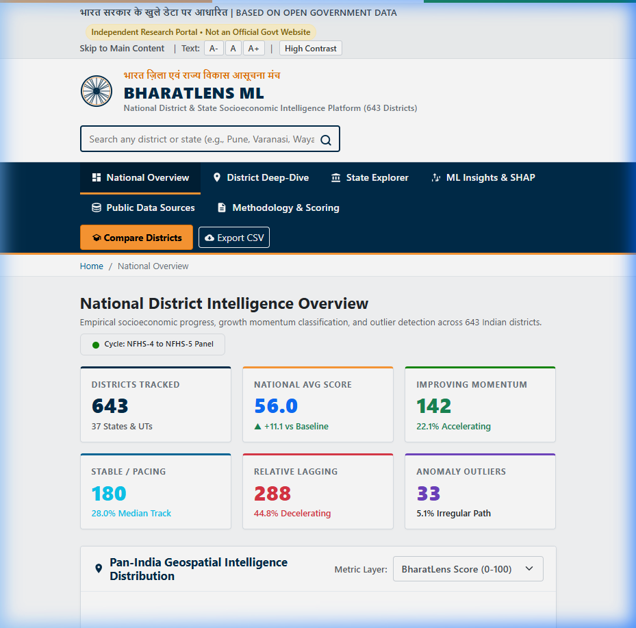
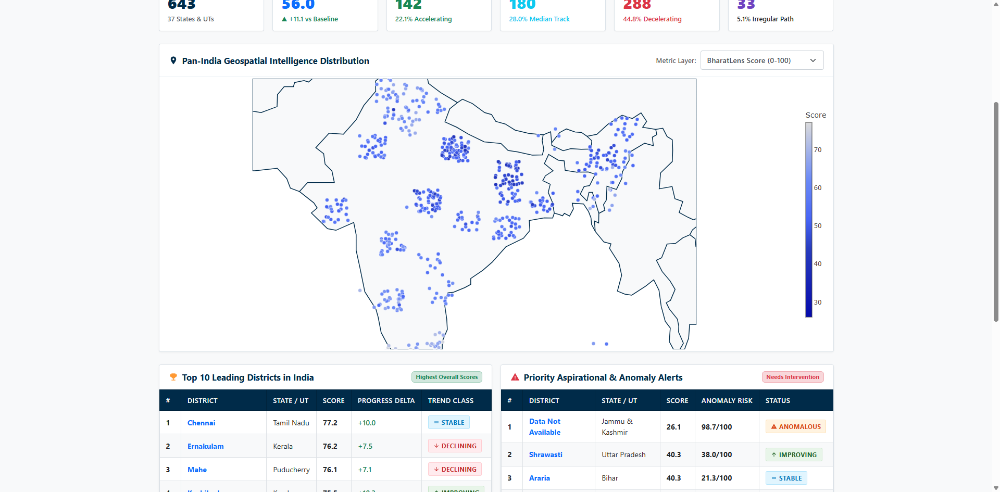
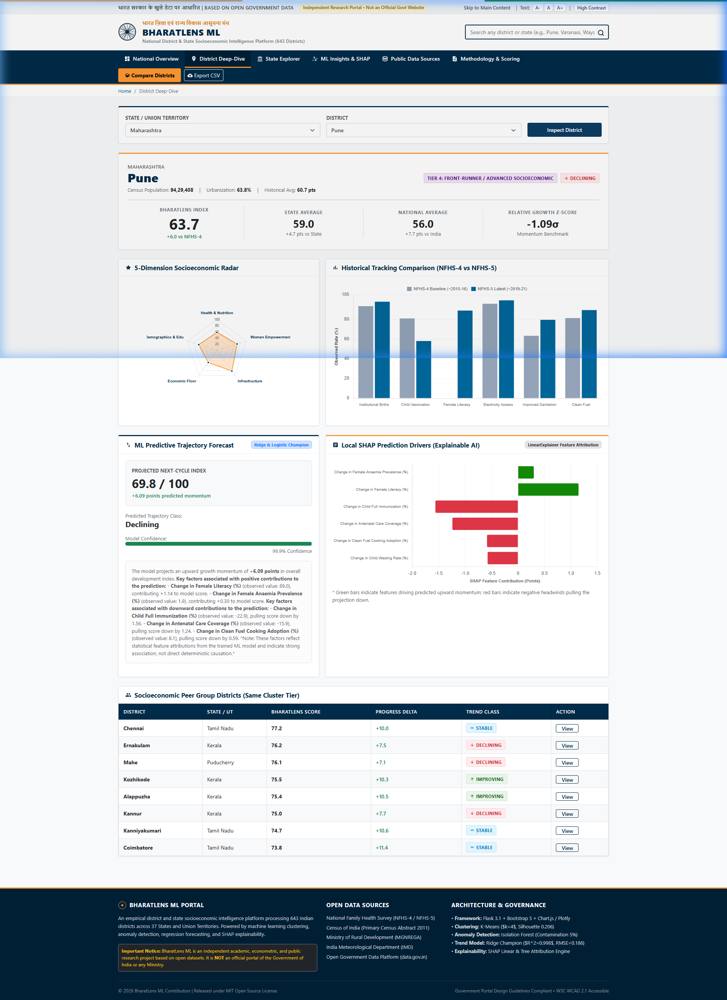
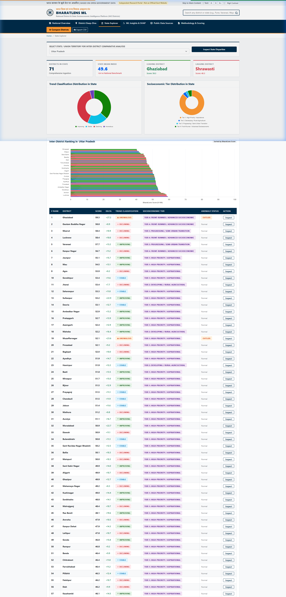
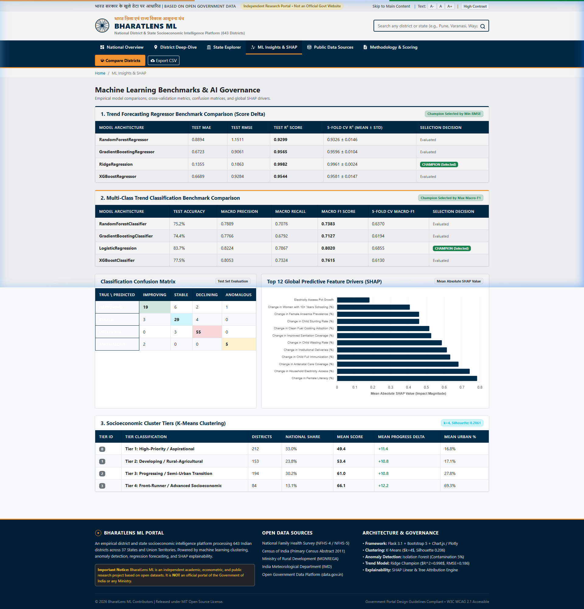
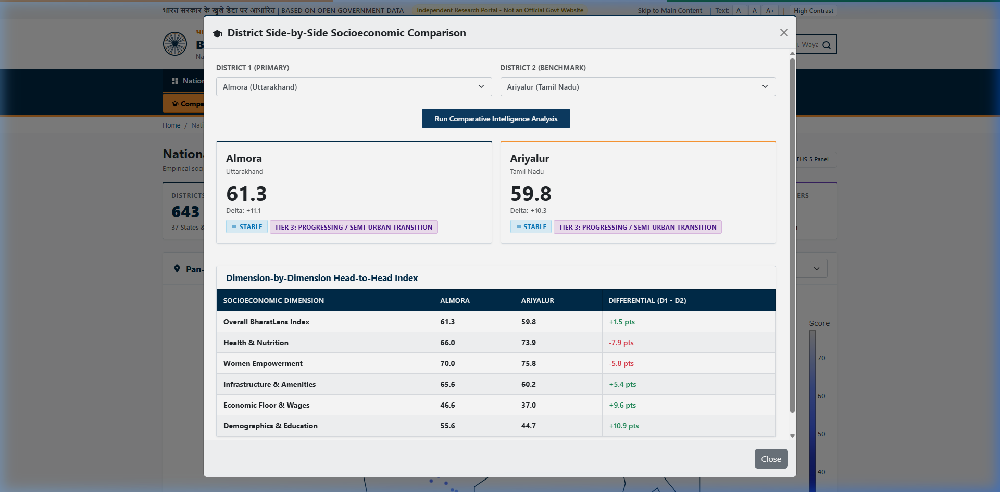

# BharatLens ML: Indian District Socioeconomic Intelligence & Trend Forecasting Platform

[](https://www.python.org/downloads/)
[](https://flask.palletsprojects.com/)
[](https://scikit-learn.org/)
[](https://docs.pytest.org/)
[](LICENSE)

> **An empirical district-level econometric and machine learning platform processing multi-period panel data across 643 Indian districts in 37 States and Union Territories. It models socioeconomic velocity, detects development anomalies, forecasts growth momentum, and attributes predictive drivers using Explainable AI (SHAP).**

---

## 1. Executive Summary

**BharatLens ML** bridges the gap between raw public survey releases and actionable policy foresight across India's administrative geography. India has over 1.4 billion people across 750+ districts, each with stark variation in demographics, industrial density, maternal healthcare access, and climate vulnerability.

National sources such as the **National Family Health Survey (NFHS)**, the **Census of India**, and **MGNREGA** collect granular metrics, but in disparate formats, frequencies, and administrative conventions. Conventional reporting relies on absolute progress or arbitrary composite rankings that hide **relative growth deceleration**: a district improves in absolute numbers while falling behind national and regional progress.

BharatLens ML harmonizes multi-source records for **643 districts**, computes an interpretable **0–100 BharatLens Composite Index**, groups districts into **four tiers via K-Means ($k=4$)**, flags trajectory divergences with **Isolation Forest and Local Outlier Factor (LOF)**, benchmarks regressors and classifiers, and explains predictions with **SHAP**. The web interface follows the **[India.gov.in](https://www.india.gov.in/)** design system, backed by 11 REST endpoints (Flask + legacy Streamlit).

---

## 2. Problem Statement

1. **National baseline drift**: Nationwide schemes (Saubhagya, Swachh Bharat, Ujjwala) lift all districts, so a naive positive delta labels almost everyone "improving" and hides relative lag.
2. **Cross-silo fragmentation**: NFHS, Census, MGNREGA and IMD use different boundaries, spellings, and cadences.
3. **Black-box rankings**: Static indices use ad-hoc weights and cannot explain why a trajectory shifts.

BharatLens ML addresses these with **peer-relative standardized velocity ($Z_{\Delta}$)**, multivariate anomaly detection, and Shapley-value attribution.

---

## 3. Key Features

- **Pan-India coverage**: 643 districts, 37 States/UTs.
- **0–100 BharatLens Score** from 23 sub-indicators in 5 dimensions: Health & Nutrition (25%), Women Empowerment (20%), Infrastructure (20%), Economic Floor & Wages (20%), Demographics & Education (15%).
- **Momentum ($Z_{\Delta}$)** against national and intra-state baselines.
- **K-Means tiers**: Aspirational, Developing, Progressing, Front-Runner.
- **Consensus anomaly flagging**: Isolation Forest (150 estimators, contamination 0.05) cross-checked with LOF ($k=20$).
- **Model benchmarking**: Ridge, RandomForest, GradientBoosting, XGBoost with automatic champion selection.
- **SHAP engine**: local waterfall charts and plain-language narratives.
- **India.gov.in UI**: accessibility tools (font scaling, high contrast, skip links), district comparison modal, instant search, CSV export.

---

## 4. Screenshots

| | |
| :--- | :--- |
|  *National overview* |  *Geospatial map & leaderboard* |
|  *District deep-dive & SHAP* |  *State explorer* |
|  *ML benchmarks* |  *District comparison* |

---

## 5. Architecture

```
Public data (NFHS-4/5, Census 2011, MGNREGA, IMD, data.gov.in)
   → Ingestion (src/data/download.py)
   → Validation (src/data/validation.py)
   → Harmonization (src/data/processing.py)
   → Scoring & momentum (src/scoring/bharatlens_score.py)
   → Feature engineering, 54 features (src/features/engineering.py)
   → Unsupervised (K-Means, IsoForest, LOF) + Supervised (Ridge, Logistic, ensembles)
   → SHAP (src/explainability/shap_analysis.py)
   → Flask portal, 11 REST endpoints (app.py)
```

**Stack**: Python 3.10+, Flask, scikit-learn, XGBoost, SHAP, pandas, NumPy, SciPy, Chart.js, Plotly.js, pytest.

**Project layout**

```
├── app.py, app_streamlit.py, run_pipeline.py
├── config/      # config.yaml, data_sources.yaml
├── data/        # raw/, external/, processed/
├── models/      # saved/ (joblib), metadata/ (benchmarks, SHAP)
├── src/         # data/, scoring/, features/, ml/, explainability/, utils/
├── static/, templates/
├── tests/       # 22 tests
└── docs/screenshots/
```

---

## 6. Data Sources

| Source | Provider | Coverage | Use |
| :--- | :--- | :--- | :--- |
| NFHS District Factsheets | IIPS & MoHFW | 639 districts, NFHS-4 (2015-16) to NFHS-5 (2019-21) | Health, nutrition, amenities |
| Primary Census Abstract | ORGI, MHA | 640 districts, 2011 | Population, literacy, workers |
| MGNREGA | MoRD | 740 districts | Wages, employment days |
| IMD Rainfall | IMD, MoES | 36 subdivisions, 1901–2015 | Rainfall normals, variability |
| District GeoJSON | Survey of India | 641 districts | Boundaries |
| OGD API | NIC / MeitY | Dynamic | Fallback to cached mirrors |

Names are matched to the Census 2011 baseline using Levenshtein distance; schemas live in `config/data_sources.yaml`.

---

## 7. Methodology

**Normalization** (per indicator $j$, district $i$, scaled to $[0,100]$):

$$\tilde{x}_{i,j} = \frac{x_{i,j} - \min_k x_{k,j}}{\max_k x_{k,j} - \min_k x_{k,j}} \times 100 \quad \text{(higher is better)}$$

$$\tilde{x}_{i,j} = \frac{\max_k x_{k,j} - x_{i,j}}{\max_k x_{k,j} - \min_k x_{k,j}} \times 100 \quad \text{(burden indicators: stunting, wasting, anaemia)}$$

**Dimension and composite scores**:

$$S_{i,d} = \frac{1}{|I_d|}\sum_{j \in I_d}\tilde{x}_{i,j}, \qquad S_i = \sum_{d=1}^{5} w_d S_{i,d}, \quad \sum w_d = 1$$

| Dimension | Weight | Core indicators |
| :--- | :---: | :--- |
| Health & Nutrition | 0.25 | Institutional deliveries, vaccination, stunting, wasting, anaemia, antenatal care |
| Women Empowerment | 0.20 | Female literacy, schooling, bank accounts, MGNREGA women persondays |
| Infrastructure | 0.20 | Electricity, sanitation, clean fuel, piped water, internet |
| Economic Floor | 0.20 | MGNREGA wage, employment days, worker participation |
| Demographics & Education | 0.15 | Literacy, sex ratio, urban share |

**Relative growth velocity** (removes national baseline drift), with $\mu_{\Delta}=11.12$, $\sigma_{\Delta}=4.31$:

$$Z_{\Delta,i} = \frac{\Delta S_i - \mu_{\Delta}}{\sigma_{\Delta}+\epsilon}, \qquad \Delta S_{i,\text{state}} = \Delta S_i - \overline{\Delta S}_{\text{state}}$$

- **Improving**: $Z_{\Delta} \ge +0.35$ or state-relative delta $\ge +1.5$
- **Stable**: $-0.35 < Z_{\Delta} < +0.35$
- **Declining**: $Z_{\Delta} \le -0.35$ or state-relative delta $\le -1.5$
- **Anomalous**: flagged by the Isolation Forest consensus filter

The 54-feature matrix includes absolute deltas, percentage growth, state z-scores, structural ratios, and a malnutrition burden index ($0.6\times$ stunting $+ 0.4\times$ wasting).

---

## 8. ML Results

**Clustering**: K-Means with $k=4$ (Silhouette 0.2061, Davies-Bouldin 1.5415).

| Tier | Districts | Mean score | Mean delta | Urban % |
| :--- | :---: | :---: | :---: | :---: |
| 1: High-Priority / Aspirational | 212 | 49.44 | +11.44 | 16.8 |
| 2: Developing / Rural-Agricultural | 153 | 53.37 | +10.81 | 17.1 |
| 3: Progressing / Semi-Urban | 194 | 61.03 | +10.82 | 27.8 |
| 4: Front-Runner / Advanced | 84 | 66.06 | +12.22 | 69.3 |

**Anomalies**: 33 districts (5.1%) flagged, e.g. Sivasagar, Bastar, Dhubri, Tirap.

**Regression** (next-cycle score delta, 80/20 split, 5-fold CV):

| Model | Test RMSE | Test $R^2$ | CV $R^2$ |
| :--- | :---: | :---: | :---: |
| RandomForest | 1.1511 | 0.9299 | 0.9326 |
| GradientBoosting | 0.9061 | 0.9565 | 0.9596 |
| XGBoost | 0.9284 | 0.9544 | 0.9581 |
| **Ridge (champion)** | **0.1863** | **0.9982** | **0.9961** |

**Classification** (Improving / Stable / Declining / Anomalous):

| Model | Accuracy | Macro F1 | CV Macro-F1 |
| :--- | :---: | :---: | :---: |
| RandomForest | 75.19% | 0.7383 | 0.6370 |
| GradientBoosting | 74.42% | 0.7127 | 0.6194 |
| XGBoost | 77.52% | 0.7615 | 0.6130 |
| **Logistic (champion)** | **83.72%** | **0.8020** | **0.6855** |

**SHAP**: top global drivers are changes in female literacy (0.785), household electricity (0.743), antenatal care (0.680), full immunization (0.634), and institutional deliveries (0.615). Attributions are associative, not causal.

---

## 9. Key Findings

1. **Baseline drift hides lag**: the average district gained +11.1 points, yet 288 districts (44.8%) grew slower than the national median.
2. **Intra-state gaps are large**: in Uttar Pradesh, Ghaziabad (59.3) and Shrawasti (40.3) differ by 19+ points.
3. **Growth levers**: female literacy, antenatal care, and immunization changes are the strongest predictors of upward mobility.

---

## 10. Quick Start

```bash
git clone https://github.com/mohdshamii/BharatLens.git
cd BharatLens
python -m venv venv
source venv/bin/activate        # Windows: .\venv\Scripts\Activate.ps1
pip install -r requirements.txt
cp .env.example .env            # Windows: copy .env.example .env
```

```bash
python run_pipeline.py          # ingestion → scoring → training → SHAP
python app.py                   # open http://localhost:5000/
streamlit run app_streamlit.py  # optional legacy dashboard
pytest -v                       # 22 tests
```

`.env` keys: `DATA_GOV_IN_API_KEY` (optional; cached data is used if empty), `CACHE_DIR`, `PROCESSED_DIR`, `MODELS_DIR`, `LOG_LEVEL`, `PORT`, `FLASK_DEBUG`.

**Deployment**

```bash
gunicorn --workers=4 --bind=0.0.0.0:5000 app:app      # Linux
waitress-serve --port=5000 app:app                    # Windows
docker build -t bharatlens-ml . && docker run -p 5000:5000 --env-file .env bharatlens-ml
```

---

## 11. API Example

`GET /api/district/Maharashtra/Pune`

```json
{
  "district": "Pune", "state": "Maharashtra",
  "bharatlens_score": 63.7, "score_change": 6.0,
  "relative_growth_zscore": -1.09, "trend": "Declining",
  "cluster_name": "Tier 4: Front-Runner / Advanced Socioeconomic",
  "ml_forecast": {"projected_next_score": 69.8, "predicted_delta": 6.09},
  "shap_analysis": {
    "top_positive": [{"feature": "Change in Female Literacy (%)", "shap_value": 1.14}],
    "top_negative": [{"feature": "Change in Child Full Immunization (%)", "shap_value": -1.56}]
  }
}
```

Other routes include `/api/summary`, `/api/state/<state>`, `/api/compare?d1=...&d2=...`, search autocomplete, and CSV export.

---

## 12. Limitations, Ethics & Roadmap

- NFHS rounds are ~5 years apart; districts are harmonized to the Census 2011 framework.
- SHAP shows model associations, not causation.
- Only aggregated open data is used (no PII); API keys stay server-side.
- **Roadmap**: satellite night-lights/NDVI, spatial GNNs, `data.gov.in` webhook sync, district policy simulator.

---

## 13. Contributing, License & References

Fork, branch (`feature/...`), run `pytest -v`, and open a Pull Request. Licensed under the [MIT License](LICENSE).

1. NFHS-5 India Report (2019-21), IIPS & MoHFW.
2. Census of India 2011, Primary Census Abstract, ORGI.
3. Barro & Sala-i-Martin (1992). *Convergence*. Journal of Political Economy, 100(2).
4. Drèze & Sen (2013). *An Uncertain Glory*. Princeton University Press.
5. Lundberg & Lee (2017). *A Unified Approach to Interpreting Model Predictions*. NeurIPS.
6. Liu, Ting & Zhou (2008). *Isolation Forest*. ICDM.
7. Pedregosa et al. (2011). *Scikit-learn*. JMLR, 12.

**Author**: Mohd Shami · [github.com/mohdshamii/BharatLens](https://github.com/mohdshamii/BharatLens)
